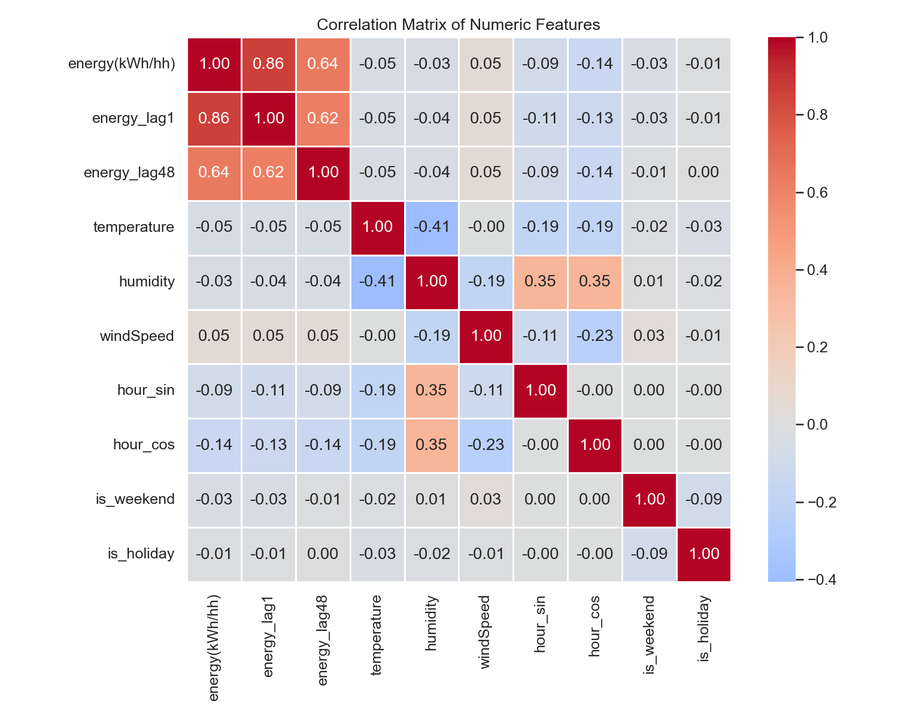

# Smart Meters in London: Household Energy Prediction

MSc Artificial Intelligence coursework (CS5812 Predictive Data Analysis, Brunel University London).

**Research question:** can we predict a household's electricity use from its recent consumption, the weather, the calendar and its socio-economic group?

The project uses the public [Smart Meters in London](https://www.kaggle.com/datasets/jeanmidev/smart-meters-in-london) dataset (UK Power Networks Low Carbon London trial), joined with hourly and daily weather and UK bank holidays.

## What's in this repo

| File | Purpose |
|---|---|
| `project_clean.ipynb` | Half-hourly pipeline: stratified sampling, merging, feature engineering and EDA |
| `project_daily.ipynb` | Daily-level version of the same analysis (daily energy vs weather) |
| `project.ipynb` | Early exploration notebook |
| `eda_*.png` | Figures exported from the EDA sections |

## Pipeline

1. **Stratified household sampling.** Households are sampled across tariff (standard vs time-of-use) and ACORN group, so the dataset stays representative while fitting in memory.
2. **One full year (2013)** of half-hourly readings, covering every season and holiday.
3. **Merges:** household metadata (ACORN, tariff), hourly weather aligned to each half-hour, and bank holidays.
4. **Feature engineering:**
   - cyclic time encoding (`hour_sin`, `hour_cos`) so 23:00 and 00:00 are neighbours
   - `is_weekend`, `is_holiday`, month and season
   - lag features: `energy_lag1` (previous half-hour) and `energy_lag48` (same time yesterday)
   - one-hot ACORN group and tariff
5. **EDA that drives modelling decisions**, summarised in a table at the end of each notebook.

## Key EDA findings

| Observation | What it means for the model |
|---|---|
| Strong morning and evening peaks in every household | Include cyclic hour features |
| Weekend load curves are flatter and later | Include `is_weekend` |
| Bank holidays look like weekends | Include `is_holiday` |
| Consumption rises as temperature falls | Include temperature |
| Affluent ACORN households use more on average | Include ACORN dummies |
| `energy_lag1` and `energy_lag48` correlate strongly with the target | Include both lags |



## Results

In the full coursework, a **Random Forest reached R² 0.817** on held-out data, compared with **R² 0.754 for a PyTorch Transformer encoder**. With strong engineered lag features, the tree ensemble beat the deep model on this tabular problem.

## Running it

```bash
pip install pandas numpy scikit-learn matplotlib seaborn jupyter
jupyter notebook project_clean.ipynb
```

Download the dataset from Kaggle and place the CSV files in a `data/` folder (ignored by git). The notebooks expect the original file names (`halfhourly_dataset`, `daily_dataset`, `weather_hourly_darksky.csv`, `informations_households.csv`, `uk_bank_holidays.csv`).
